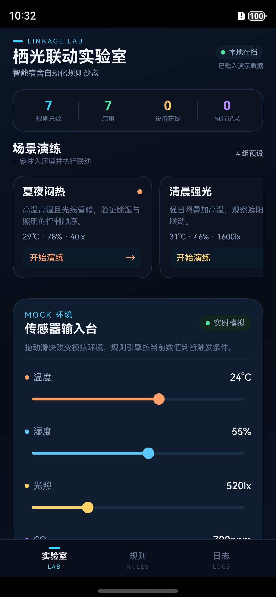
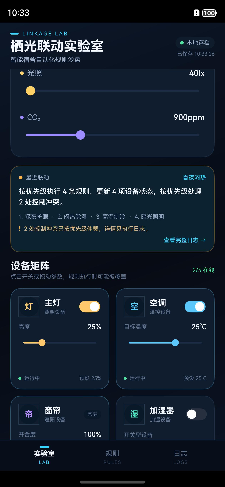
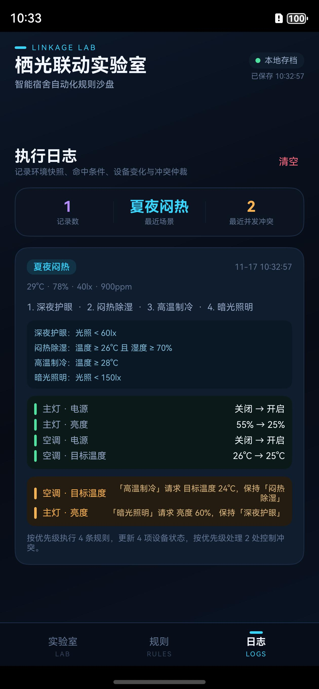
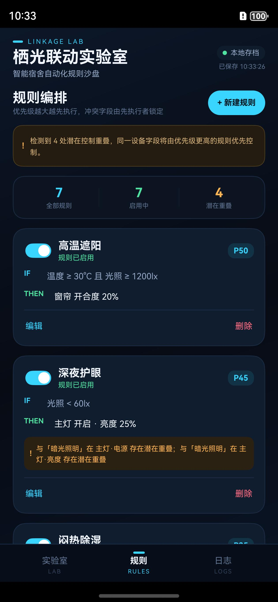
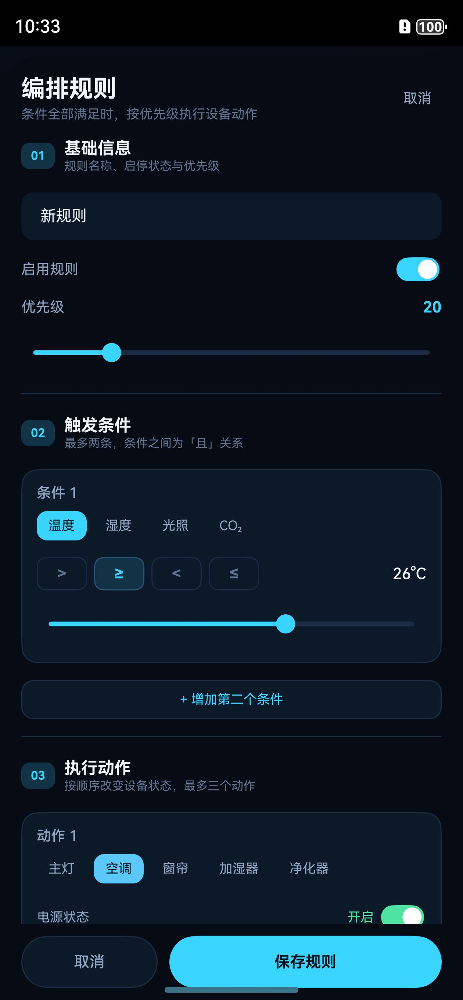
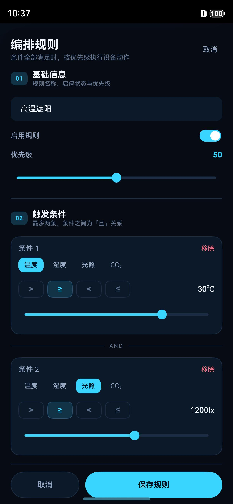
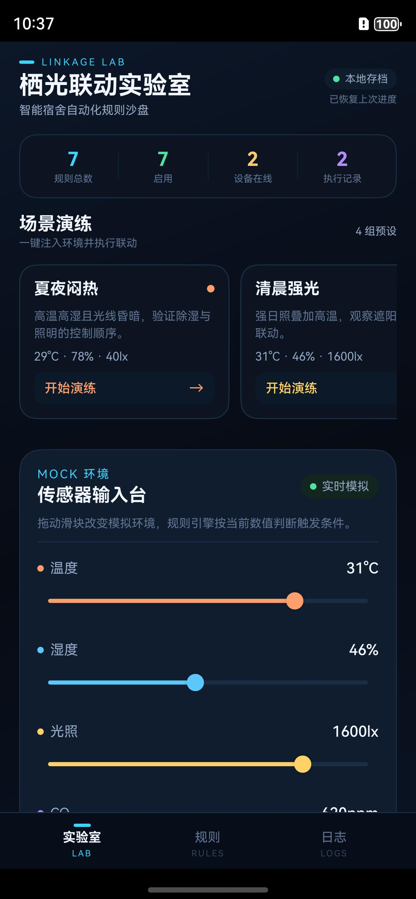
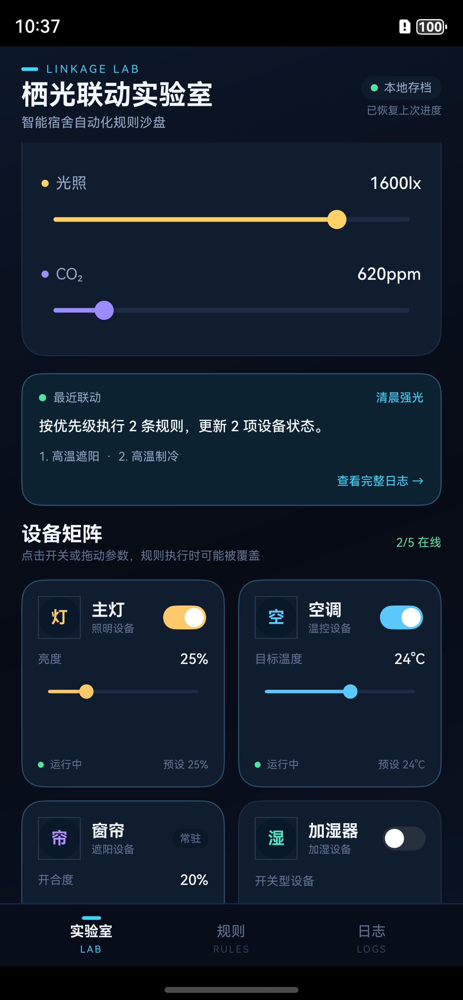

# 栖光联动实验室

智能宿舍自动化规则编排与联动模拟 App，课程期末大作业作品。

- 选题：主题三「联动实验室」
- 作者：王金宝（20230313218）
- GitHub：w1044361472-ww
- 仓库：https://github.com/w1044361472-ww/linkage-lab
- 完成方式：独立完成
- 开发环境：DevEco Studio 5.0.5，HarmonyOS 5.0.5（API 17），ArkTS / ArkUI

## 1. 项目简介

栖光联动实验室面向智能宿舍场景。用户可以调节温度、湿度、光照和 CO₂ 四项模拟传感器数据，设计“满足条件时执行设备动作”的联动规则，并观察规则引擎如何匹配条件、按优先级执行、处理控制冲突和记录执行日志。应用完全离线运行，使用 Preferences 持久化环境、设备、规则与日志，结束进程后重新打开可恢复上次进度。

## 2. 功能清单

| 能力 | 实现情况 |
| --- | --- |
| Mock 环境 | 温度、湿度、光照、CO₂ 四项滑块 |
| 可控设备 | 主灯、空调、窗帘、加湿器、净化器 5 类 |
| 规则管理 | 新增、编辑、启停、删除；1—2 个条件、1—3 个动作、优先级 1—99 |
| 双条件规则 | 默认规则包含「闷热除湿」「高温遮阳」两条双条件规则 |
| 规则引擎 | 全部条件 AND 判定；优先级降序、ID 升序；设备字段锁；冲突仲裁；规则重叠检测 |
| 场景演练 | 夏夜闷热、清晨强光、冬日干燥、自习归来 4 组场景 |
| 执行日志 | 环境快照、命中条件、设备变化、执行顺序、冲突记录，最多 30 条 |
| 持久化 | Preferences 保存环境、设备、规则、日志；重启恢复；损坏存档回退默认数据 |
| 自动化测试 | 17 条 Hypium 测试全部通过，覆盖正常、边界、异常 |

## 3. 界面截图

| 实验室首页 | 场景执行结果 |
| --- | --- |
|  |  |

| 执行日志 | 规则编排 |
| --- | --- |
|  |  |

| 规则编辑器 | 双条件规则 |
| --- | --- |
|  |  |

| 进程重启恢复 | 设备状态恢复 |
| --- | --- |
|  |  |

录屏：`docs/demo.mp4`（60 秒，演示场景执行、冲突日志、规则编辑与进程重启恢复）

系统架构图：`docs/images/architecture.png`

业务流程图：`docs/images/flow.png`

## 4. 系统架构

应用为单 HAP 的 ArkTS / ArkUI 工程，按表现层、业务逻辑层、持久化层和运行环境划分：

- 表现层：`pages/Index.ets` 负责三页导航和状态调度；`components/` 提供环境面板、规则卡片、规则编辑器、日志卡片和场景卡片。
- 业务逻辑层：`engine/RuleEngine.ets` 负责条件判定、规则排序、设备字段锁、冲突仲裁和重叠检测；`data/Defaults.ets` 提供设备、规则、场景种子；`model/Models.ets` 定义数据模型与克隆函数。
- 持久化层：`storage/Codec.ets` 完成 JSON 编解码、版本校验、规则/日志清洗和数值边界处理；`storage/PreferencesRepository.ets` 使用 `@kit.ArkData` Preferences 读写 `lab_state_v1`。
- 运行环境：`EntryAbility` 注入 `labAbilityContext`，加载 `pages/Index`；Hypium 测试直接导入 RuleEngine 与 Codec。

典型数据流：页面调整环境 → `RuleEngine.run()` 读取规则和设备 → 生成 `EngineResult` → 页面更新设备数组和日志 → `PreferencesRepository.save()` 写入 Preferences → 重启时 `load() → StateCodec.decode()` 恢复。

详见 [软件需求说明书](docs/软件需求说明书.md)。

## 5. 关键业务规则

1. 每条规则的条件全部满足才命中（AND）。
2. 命中规则按 `priority` 降序执行；优先级相同按 `id` 升序。
3. 同一设备同一字段（电源或数值）由首个写入规则锁定；后续规则请求不同值时跳过并记录冲突。
4. 设备数值超出范围时 clamp 到设备上下限。
5. 动作引用未知设备时忽略该动作，不影响其他动作。
6. 日志保留最近 30 条；规则最多 50 条。

冲突示例：夏夜闷热场景同时命中「深夜护眼」「暗光照明」「闷热除湿」「高温制冷」。主灯亮度由 P45 的「深夜护眼」锁定为 25%，P20 的「暗光照明」请求 60% 被记录为冲突；空调目标温度由 P35 的「闷热除湿」锁定为 25°C，P30 的「高温制冷」请求 24°C 被记录为冲突。

## 6. 数据持久化

- Preferences 名称：`linkage_lab_store`
- 状态 key：`lab_state_v1`
- 版本号：`1`
- 保存时机：设备开关、规则变更、日志新增立即保存；环境滑块和数值滑块使用 260ms 防抖保存；页面隐藏时再次保存。
- 恢复时机：应用启动时读取；无存档或存档无效时载入默认演示数据。
- 异常处理：JSON 损坏、版本不符、设备数组为空时返回 null；非法规则和日志条目被过滤；数值越界被修正。

## 7. 开发环境与运行方法

### 7.1 环境

- DevEco Studio 5.0.5
- HarmonyOS SDK 5.0.5（API 17）
- 本地模拟器：HarmonyOS 5.0.5 Phone x86_64（1260×2720）
- 测试框架：Hypium 1.0.21，hamock 1.0.0

### 7.2 在 DevEco Studio 中运行

1. 使用 DevEco Studio 打开项目根目录。
2. 等待 Sync 完成；如依赖未安装，在项目根目录执行 `ohpm install`。
3. 在 Project Structure → Signing Configs 中启用自动签名。
4. 启动 API 17 模拟器或连接 HarmonyOS 设备。
5. 选择 `entry` 模块并运行。

### 7.3 命令行构建（可选）

```text
hvigorw --mode module -p product=default -p module=entry@default -p buildMode=debug assembleHap
```

构建产物位于 `entry/build/default/outputs/default/`。安装到设备前需使用 DevEco Studio 自动签名或本地签名配置。

### 7.4 运行单元测试

DevEco Studio：右键 `entry/src/test` → Run。

命令行：

```text
hvigorw --mode module -p product=default -p module=entry@default -p buildMode=debug test
```

测试结果会写入 `entry/.test/default/intermediates/test/coverage_data/test_result.txt`；仓库中另存于 `docs/test_result.txt`。

## 8. 测试结果

```text
class=RuleEngineTest
test=normal_single_condition_triggers_device
result=Success
...
class=StateCodecTest
test=exception_invalid_rule_is_dropped
result=Success
Tests run: 17, Failure: 0, Error: 0, Pass: 17, Ignore: 0
```

核心模块覆盖率（行覆盖）：

| 模块 | 行覆盖率 | 函数覆盖率 |
| --- | --- | --- |
| RuleEngine.ets | 81.3% | 88.9% |
| StateCodec.ets | 71.8% | 86.7% |
| Defaults.ets | 77.4% | 64.3% |
| 全部统计 | 70.1% | 60.9% |

证据文件：`docs/test_result.txt`、`docs/test_coverage.json`。

测试覆盖：

- 正常：单条件触发、双条件同时满足、优先级冲突仲裁、停用规则、规则重叠、纯开关设备动作、存档往返。
- 边界：阈值等值判断、设备数值 clamp、空规则、日志裁剪、超出范围的持久化数值。
- 异常：未知设备动作、非法 JSON、版本不符、设备数组为空、非法规则清洗。

## 9. 目录结构

```text
dazuoye/
├─ AppScope/                         应用级配置与资源
├─ entry/
│  ├─ src/main/ets/
│  │  ├─ pages/Index.ets             页面编排与状态调度
│  │  ├─ components/                 环境面板、设备、规则、日志、场景组件
│  │  ├─ engine/RuleEngine.ets       规则引擎
│  │  ├─ data/Defaults.ets           设备/规则/场景默认数据
│  │  ├─ model/Models.ets            实体、枚举与克隆
│  │  ├─ storage/Codec.ets           JSON 编解码与清洗
│  │  ├─ storage/PreferencesRepository.ets
│  │  ├─ theme/Palette.ets
│  │  ├─ common/Formatters.ets
│  │  └─ entryability/EntryAbility.ets
│  ├─ src/test/                      Hypium 本地单元测试
│  └─ src/ohosTest/                  设备测试模板
├─ docs/
│  ├─ 软件需求说明书.md
│  ├─ images/                        架构图、流程图
│  ├─ screenshots/                   真实运行截图
│  ├─ demo.mp4                       真实运行录屏
│  ├─ test_result.txt                测试输出
│  └─ test_coverage.json             覆盖率数据
├─ report/                           期末大作业 Word 报告
└─ README.md
```

## 10. 交付说明

- 报告：`report/鸿蒙高级应用开发工程师认证-20230313218-王金宝-期末大作业报告.docx`
- 运行录屏：`docs/demo.mp4`
- 需求说明书：`docs/软件需求说明书.md`
- GitHub 仓库：https://github.com/w1044361472-ww/linkage-lab
- GitHub 账号：w1044361472-ww

## 11. 后续可改进方向

1. 增加规则条件的时间维度（当前无系统时间条件）。
2. 增加规则分组和场景模板导入导出。
3. 使用 RDB 替代 Preferences 存储大量历史日志。
4. 增加无障碍标签和横屏布局适配。
5. 将规则执行引擎抽取为 HAR，供其他智能家居应用复用。
